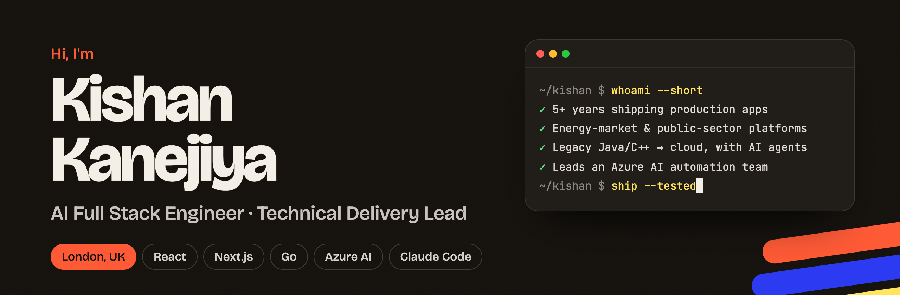

  
  
  

## 👋 About me

I'm a full stack engineer and delivery lead with **5+ years shipping production platforms**. I started as a React developer and now lead **AI-driven modernisation and automation**. I own delivery end to end, from the interface to cloud deployment, and use AI to rebuild legacy code faster without lowering the quality bar.

Most of my recent work is enterprise-grade systems for **regulated sectors**: the UK gas and electricity markets and UK government-led initiatives.

 

## 🧭 What I bring

<table>
  <tr>
    <td width="50%" valign="top">
      <h3>🤖 AI delivery</h3>
      LLM integration, Azure AI workflow automation, prompt engineering, and AI-assisted development with coding agents such as Claude Code. Every AI-written change is tested before it ships.
    </td>
    <td width="50%" valign="top">
      <h3>🧱 Full stack engineering</h3>
      React, Next.js, TypeScript, Redux and Vue on the front end; Go services, REST and GraphQL APIs, and event-driven integrations behind them.
    </td>
  </tr>
  <tr>
    <td valign="top">
      <h3>☁️ Modernisation &amp; cloud</h3>
      Moving legacy Java and C++ systems onto cloud architecture, containerising services, and running them behind Zero Trust networking.
    </td>
    <td valign="top">
      <h3>🧑‍✈️ Leadership</h3>
      Running a delivery team, setting release quality gates, architecture decisions, code review, stakeholder reporting, Agile Scrum.
    </td>
  </tr>
</table>

 

## 📈 Selected impact

- **Billions of data points → decisions.** Built data-rich dashboards for national energy-market regulators and industry bodies, turning huge datasets into reports non-technical users act on.
- **Compliance-critical journeys.** Led the front end for a government claims portal, smart-meter consent flows and KYC onboarding.
- **Legacy → cloud, with AI agents.** Moved legacy hosting and Java/C++ codebases to the cloud, and rewrote full production platforms end to end with AI coding agents, testing every change before release.
- **Faster stacks.** Engineered high-performance Go backend services paired with React front ends, replacing slower, harder-to-maintain stacks.
- **Resilient LLM pipelines.** Head of an Azure AI automation team: two-way email processing wired into decision workflows, with pipelines that survive slow responses, retries and failed API calls without breaking a run.
- **Secure by default.** Containerised, monitored deployments behind Zero Trust networking with no open inbound ports, plus design-to-code and security review workflows that catch vulnerabilities earlier.
- **Consumer scale.** Headed front-end development for a B2C product with **5,000+ daily users**, lifting engagement by **~30%**, and migrated it from Nuxt.js to Next.js for better Core Web Vitals, SEO and speed.

 

## 🛤️ Career path

| When | Role | Focus |
| --- | --- | --- |
| **2023 – now** · London | React Developer → **AI Full Stack Delivery Lead** | Regulated energy-market and public-sector platforms · AI-assisted modernisation · Azure AI automation team |
| **2021 – 2023** · India | Frontend Developer | B2C product with 5,000+ daily users · Nuxt → Next.js migration · KPI reporting |
| **2019 – 2021** · India | Frontend Developer | E-commerce storefronts, inventory and order management (Vue.js, React) |

🎓 MSc Information &amp; Communication Technology (2021) · BSc Information Technology (2019)

 

## 🚀 Featured projects

<table>
  <tr>
    <td colspan="2" valign="top">
      
      <h3><a href="https://seensooner.kishankanejiiya.tech">SeenSooner</a> </h3>
      Find where you'll be seen sooner on the NHS. It reads the live A&amp;E, urgent treatment centre and minor injuries waits that 15 trusts and health boards publish (about 70 sites), each in its own format, and shows them hospital by hospital near your postcode, keeping each trust's own definition and update time. Banded figures stay banded, and a failing source never breaks the page. For planned care, a stdlib Python pipeline turns NHS England's 80 MB monthly waiting-list extract into median waits for 506 providers and 20 specialties, so you can see that a hip or knee wait is 5 weeks at one London hospital and 16 at another 7 miles away, then use your legal right to choose. It's designed like a real public-service site, after studying NHS trust pages, but with its own identity rather than NHS branding. It has no backend and no database, stores nothing about visitors, and scores 100 on Lighthouse for SEO and accessibility.
        
      <code>Next.js 16</code> <code>React 19</code> <code>TypeScript</code> <code>Python</code> <code>NHS open data</code> <code>WCAG 2.2 AA</code> <code>Technical SEO</code> <code>Docker</code> <code>Cloudflare Tunnel</code>
    </td>
  </tr>
  <tr>
    <td colspan="2" valign="top">
      <a href="https://doorstep.kishankanejiiya.tech">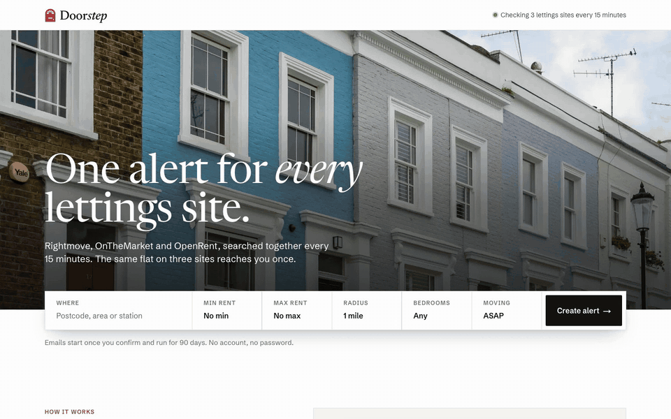</a>
      <h3><a href="https://doorstep.kishankanejiiya.tech">Doorstep</a> </h3>
      One rental alert for every UK lettings site. You set an area, rent, bedrooms and a move date once; every 15 minutes an n8n pipeline runs that search on Rightmove, OnTheMarket and OpenRent, merges the same flat listed on several sites into one entry, and emails only what's new. Postgres does the matching: a silent first-scan baseline so nobody is flooded, cross-site dedupe that never sends one home twice, and a window that starts eight weeks before your move. Double opt-in, no account, one-click stop, and the Next.js site only talks to n8n over the internal Docker network.
        
      <code>n8n</code> <code>Next.js 16</code> <code>PostgreSQL</code> <code>Supabase</code> <code>Docker</code> <code>Cloudflare Tunnel</code> <code>Technical SEO</code>
    </td>
  </tr>
  <tr>
    <td colspan="2" valign="top">
      <a href="https://airadar.kishankanejiiya.tech">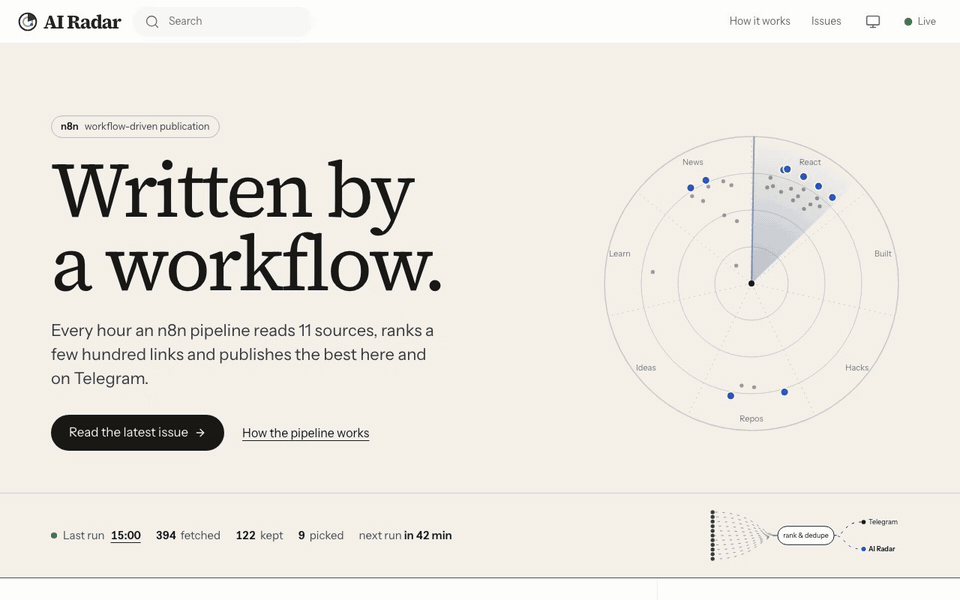</a>
      <h3><a href="https://airadar.kishankanejiiya.tech">AI Radar</a> </h3>
      A publication written by a workflow. Every hour my n8n pipeline reads 11 AI and full-stack sources and ranks a few hundred links, then publishes the best on a Medium-style site and on Telegram. The workflow posts each run to a private ingest API (bearer token, internal Docker network only), and runs are stored in Postgres in a least-privilege schema on self-hosted Supabase. A Go worker fetches link previews behind an SSRF guard. The site has issues, story pages, topics, full-text search, claps, RSS and a live pipeline strip.
        
      <code>n8n</code> <code>Go</code> <code>Next.js 16</code> <code>PostgreSQL</code> <code>Supabase</code> <code>Telegram Bot API</code> <code>Docker</code>
    </td>
  </tr>
  <tr>
    <td width="50%" valign="top">
      <a href="https://sift.kishankanejiiya.tech">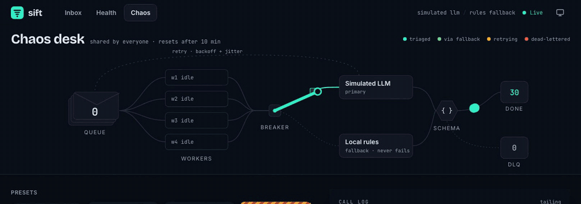</a>
      <h3><a href="https://sift.kishankanejiiya.tech">Sift</a> </h3>
      AI triage for support tickets, built around the part most LLM demos skip: what happens when the model is slow, rate-limited or returns broken JSON. It has a durable queue with leases, retries with backoff and jitter, a circuit breaker that falls back to a rules engine, and a dead-letter queue you can replay. A chaos desk lets you inject failures and watch the breaker trip live.
        
      <code>Go</code> <code>Next.js 16</code> <code>Claude API</code> <code>SQLite</code> <code>SSE</code> <code>Docker</code>
    </td>
    <td width="50%" valign="top">
      <a href="https://gridpulse.kishankanejiiya.tech">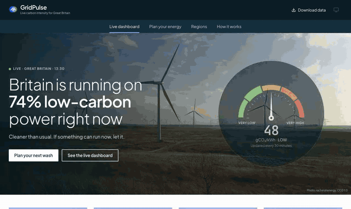</a>
      <h3><a href="https://gridpulse.kishankanejiiya.tech">GridPulse</a> </h3>
      How clean is Britain's electricity right now, and when should you run the dishwasher? A live carbon-intensity gauge, generation and carbon by fuel, and a 48-hour forecast you can drag through, for Great Britain and all 14 regions. A Go planner finds the greenest window for any appliance and deadline, and the "grid stories" are written from the data itself. You can download the data as CSV.
        
      <code>Go</code> <code>Next.js 16</code> <code>SQLite</code> <code>SVG data viz</code> <code>Docker</code>
    </td>
  </tr>
  <tr>
    <td width="50%" valign="top">
      <a href="https://burnbox.kishankanejiiya.tech">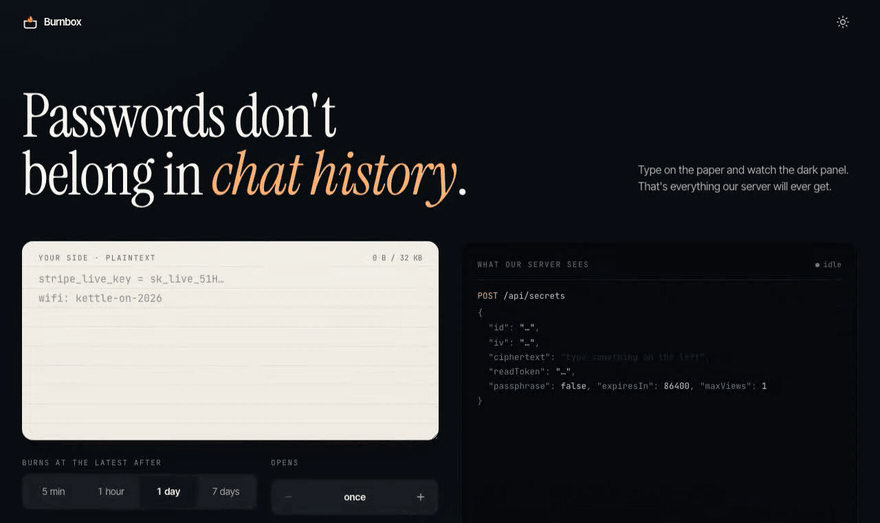</a>
      <h3><a href="https://burnbox.kishankanejiiya.tech">Burnbox</a> </h3>
      One-time secret links that burn after reading. Secrets are encrypted in the browser with AES-256-GCM, the key lives in the URL fragment, and an optional passphrase is stretched with PBKDF2 and combined with HKDF. The server only ever stores ciphertext, and a live panel shows you exactly what it receives. Burn-after-read is atomic, and link-preview bots can't use up a view.
        
      <code>WebCrypto</code> <code>Go</code> <code>Next.js 16</code> <code>SQLite</code> <code>Threat model</code>
    </td>
    <td width="50%" valign="top">
      <a href="https://tillflow.kishankanejiiya.tech">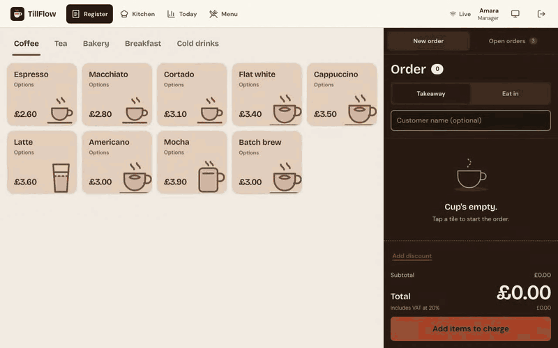</a>
      <h3><a href="https://tillflow.kishankanejiiya.tech">TillFlow</a> </h3>
      A touch-first point of sale for small cafés. The register handles modifiers, VAT and cash change down to the penny, and orders land on a kitchen rail as paper tickets over Server-Sent Events. Staff sign in with argon2id PINs, roles are enforced in the API, and idempotency keys mean a double tap never charges twice. Demo PINs are on the sign-in screen.
        
      <code>Go</code> <code>Next.js 16</code> <code>SSE</code> <code>SQLite</code> <code>RBAC</code> <code>Docker</code>
    </td>
  </tr>
  <tr>
    <td colspan="2" valign="top">
      <a href="https://dronafit.kishankanejiiya.tech">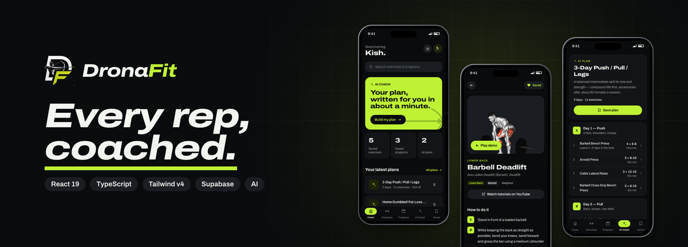</a>
      <h3><a href="https://dronafit.kishankanejiiya.tech">DronaFit</a> </h3>
      A fitness coach in your pocket: a 417-exercise library with form cues, 30 coach-built programs and an AI coach that writes your weekly plan. It has a responsive shell (bottom tabs on phones, sidebar on desktop), light and dark themes, email-OTP or guest access, and row-level security on every user table.
        
      <code>React 19</code> <code>TypeScript</code> <code>Vite 8</code> <code>Tailwind CSS 4</code> <code>Supabase</code> <code>Docker + nginx</code> <code>AI</code>
    </td>
  </tr>
  <tr>
    <td width="50%" valign="top">
      <a href="https://linkstack.kishankanejiya-mscict19.workers.dev/">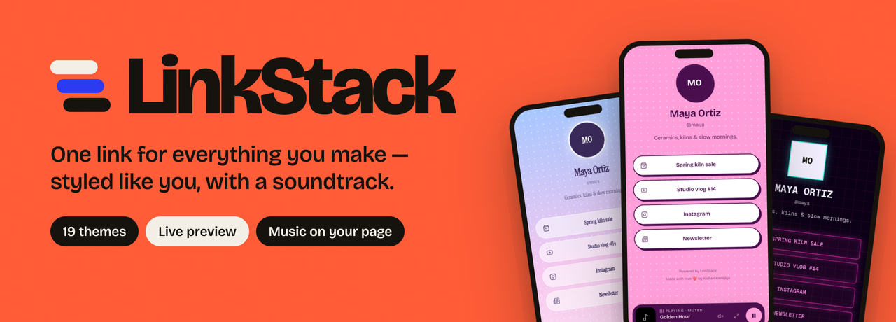</a>
      <h3><a href="https://linkstack.kishankanejiya-mscict19.workers.dev/">LinkStack</a> </h3>
      A link-in-bio platform, now at MVP: 19 themes, a live phone preview, and a YouTube soundtrack that autoplays within browser rules. One render model powers the public page, the editor preview and the theme picker.
        
      <code>Next.js 16</code> <code>React 19</code> <code>TypeScript</code> <code>Appwrite</code> <code>Cloudflare Workers</code>
    </td>
    <td width="50%" valign="top">
      <a href="https://blinkgames.fun">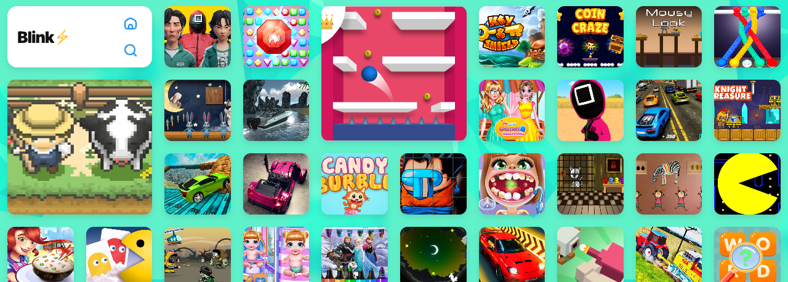</a>
      <h3><a href="https://blinkgames.fun">BlinkGames</a> </h3>
      A mobile-first HTML5 games portal. An idempotent importer loads a 23.5k-game licensed catalogue into self-hosted Supabase, and ad slots are reserved so the layout never shifts.
        
      <code>Next.js 15</code> <code>React 19</code> <code>Supabase</code> <code>PostgreSQL</code> <code>Server Components</code>
    </td>
  </tr>
  <tr>
    <td colspan="2" valign="top">
      <a href="https://expense-tracker.kishankanejiya-mscict19.workers.dev/">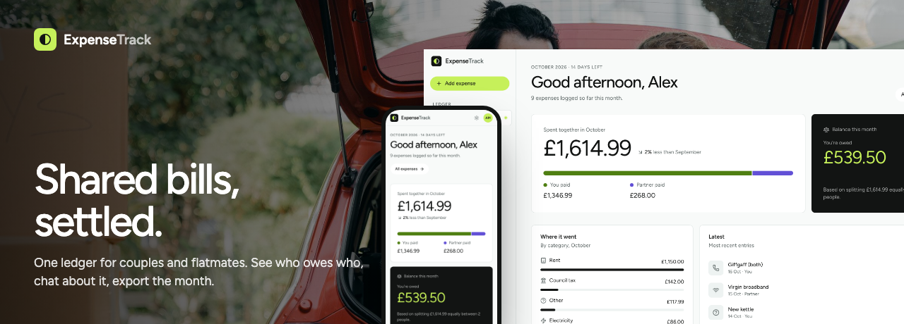</a>
      <h3><a href="https://expense-tracker.kishankanejiya-mscict19.workers.dev/">ExpenseTrack</a> </h3>
      Shared bills for couples and flatmates. Everyone in a room logs rent, energy and the big shop into one ledger, and the overview works out each person's equal share and says plainly who owes who. It adds 30-day to 12-month analytics, realtime room chat, one-link invites and CSV export for any date range. Row-level security covers every table, joining a room only happens through a validated invite function, and it runs on my self-hosted Supabase.
        
      <code>Next.js 15</code> <code>React 19</code> <code>TypeScript</code> <code>Tailwind CSS 4</code> <code>Supabase</code> <code>Realtime</code> <code>Cloudflare Workers</code>
    </td>
  </tr>
  <tr>
    <td colspan="2" valign="top">
      <a href="https://linkmap.pages.dev">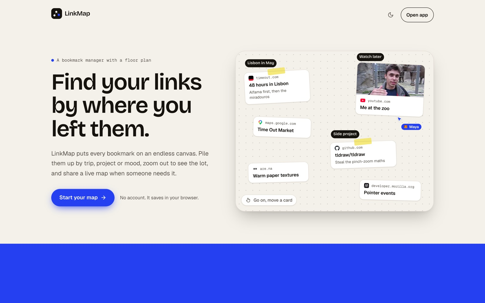</a>
      <h3><a href="https://linkmap.pages.dev">LinkMap</a> </h3>
      Bookmarks on an endless canvas, so you find links by where you left them instead of scrolling a list. Paste anywhere to pin a link, drag it into a pile, and zoom with a trackpad, a scroll wheel or a pinch on your phone. One link turns a map into a live room with presence, emoji faces and an activity timeline of every add, edit and removal. Personal maps need no account and export as JSON.
        
      <code>Next.js 15</code> <code>React 19</code> <code>TypeScript</code> <code>Supabase Realtime</code> <code>Edge Functions</code> <code>GSAP</code> <code>Cloudflare Pages</code>
    </td>
  </tr>
</table>

> [!NOTE]
> **Why some repos are private.** Most of these are early-stage products, so their source stays private while they grow from MVP. SeenSooner is open source because it's built on public NHS data. Each one runs in hardened containers on my own server behind a Cloudflare Tunnel, with no open inbound ports. They're all live, so give them a try. I'm always happy to walk through the code, architecture and trade-offs on a call. [Just ask on LinkedIn](https://linkedin.com/in/kishankanejiya).

 

## 🧰 Tech stack

**Languages & front end**
 

**Back end & data**
 

**Cloud, quality & tooling**
 

**AI**
 

 

## 🛠️ How I work

- **Ship the whole thing.** From UI to cloud deployment, I don't stop at "works on my machine".
- **AI-accelerated, human-verified.** AI agents write a lot of code fast; tests and review decide what ships.
- **Fast and accessible by default.** Core Web Vitals, server-side rendering, technical SEO and WCAG are part of the work, not a later ticket.
- **Security in the loop.** Security reviews, dependency hygiene and least-privilege permissions from day one.

 

## 📫 Let's talk

I'm always happy to chat about AI-assisted delivery, modernising legacy systems, or building fast, accessible products.

  
  

